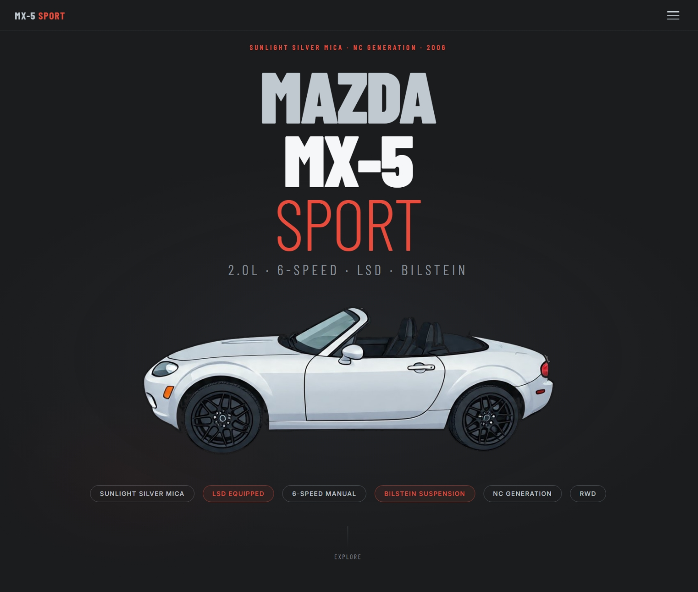

# Miata

An enthusiast page for my 2006 Mazda MX-5 Miata Sport in Sunlight Silver,
plus general Miata reference info. Single self-contained `index.html`,
no build step, no backend.

Live: https://dhrandy.github.io/miata/



## What's on the page

- **My car**: 2006 MX-5 Miata Sport (NC), Sunlight Silver, full specs,
  Sport Suspension Package details, and engineering highlights
- **Miata facts**: all four generations (NA, NB, NC, ND), global production
  milestones, and exterior colors
- **Reference**: dimensions, tire and wheel fitment, maintenance intervals,
  and a VIN / build sheet reference
- **Market context**: 2006 trim pricing, competitor context, what it actually
  costs to own, and whether the Sport trim is actually rare
- **Glossary** of Miata terms

## Run it locally

Just open `index.html` in a browser, or serve the folder with any static
server:

```sh
python3 -m http.server 8000
```

## Updating

Edit `index.html` directly and commit. GitHub Pages rebuilds automatically.

## Trademark notice

Miata, MX-5, and Mazda are trademarks of Mazda Motor Corporation.
This is an unofficial enthusiast page, not affiliated with or endorsed by Mazda.
